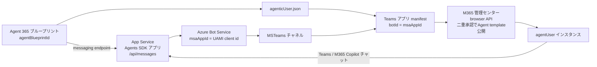
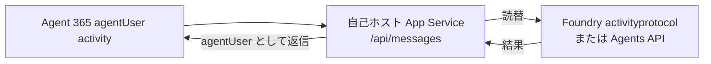

# アーキテクチャ — 2 種類のブループリントと公開経路

## 0. 要求から公開経路を固定する

- **AI teammate / AIチームメイト / AI チームメイト / Agent Template / Foundry Autopilot** は
  `foundry-autopilot` スキルへルーティングする。明示的な自己ホスト要件がなければ
  `hosting: "foundry-autopilot"` とし、[foundry-autopilot.md](foundry-autopilot.md) の
  `publish_foundry_autopilot.py --check` → `--execute` を使う。
- 明示的な Agent Template / Autopilot 要求の前提が不足／未確認なら停止する。
  通常 Agent や自己ホストへ自動で代替しない。独自ランタイム等の自己ホスト要件は、
  明示選択された別経路として §4 と [self-hosted-agent.md](self-hosted-agent.md) で対応する。
- **Autopilot の発行契約**は、同じ agent version を `digital_worker_type=m365` で作成し、
  その `blueprint.client_id` を `agenticUserTemplate.AgentIdentityBlueprintId` に使って
  `publishAsAutopilot=true`・`useAgenticUserTemplate=true`・`agenticUserTemplate` を揃えること。
  汎用 `scripts/deploy.py` / SDK `agents.create_version` だけではこの契約を満たさない。
- HTTP 成功・通常 Registry 行・Teams app ID だけで完了にしない。M365 **Requests の Type = Agent template** と、
  承認後の Teams **Agents for your team** での採用（hire）を手動確認する。
  未確認なら承認待ち／採用待ちと報告し、推測した read-back API は使わない。

## 1. 「ブループリント」は 2 種類ある（最頻出の混同）

| | Foundry マネージド ID ブループリント | Agent 365 エージェント ID ブループリント |
|---|---|---|
| 何の設計図か | エージェントが Azure リソースへアクセスするための**マネージド ID** | インストールごとに払い出す**Entra Agent ID** |
| 識別子 | 名前（例: `your-agent`）。`.env` の `BLUEPRINT_ID` | GUID。`.env` の `A365_AGENT_BLUEPRINT_ID` |
| 作成方法 | `python scripts/create_blueprint.py --name <name>` | `a365 setup blueprint -n <name> --no-endpoint` |
| API | Foundry データプレーン REST `/managedAgentIdentityBlueprints`（`api-version=v1`） | Agent 365 CLI（Entra + Agent 365 サービス） |
| 参照先 | `agent.yaml` の `blueprint_reference` | `teams/agenticUser.template.json` の `agentIdentityBlueprintId` |
| 共有可否 | `lifecycle=Manual` なら複数エージェントで共有可。`Auto` は所有エージェント専用 | インストール単位でインスタンスを払い出す |

**両者は無関係**。Foundry 側のブループリントを作っても Agent 365 のインスタンス化は起きないし、
その逆も成立しない。名前が似ているだけなので、変数名でも常に区別する。

## 2. インスタンスが作られない典型原因

以下の manifest / ZIP は**自己ホスト経路**の契約。Autopilot は §0 の version 作成・M365 publish 契約を使う。

`copilotAgents.customEngineAgents[]` の `functionsAs` の既定値は `agentOnly`
（= 通常のエージェントとしてインストールされるだけ = 全員が同じ 1 体を共有）。
インストールごとに専用の Entra Agent ID を持たせるには、manifest に次の 2 つが**両方**必要。

```jsonc
"copilotAgents": {
  "customEngineAgents": [
    {
      "id": "${INSTANCE_IDENTITY_CLIENT_ID}",
      "type": "bot",
      "functionsAs": "agenticUserOnly",          // ← devPreview のみ
      "agenticUserTemplateId": "${AGENT_NAME}-agentic-user"
    }
  ]
},
"agenticUserTemplates": [                         // ← GA 1.25+ / devPreview
  { "id": "${AGENT_NAME}-agentic-user", "file": "agenticUser.json" }
]
```

## 3. manifest スキーマの選び方

| 目的 | `manifestVersion` | `$schema` | 備考 |
|---|---|---|---|
| インスタンス化エージェント | `devPreview` | `.../teams/vDevPreview/MicrosoftTeams.schema.json` | `functionsAs` / `agenticUserTemplateId` は **devPreview にしか無い**（GA 1.25〜1.29 には存在しない） |
| 共有エージェント | `1.22` | `.../teams/v1.22/MicrosoftTeams.schema.json` | `agenticUserTemplates` と agentic-user 系プロパティを削除する |

`scripts/build_teams_package.py` は `A365_AGENT_BLUEPRINT_ID` の有無でこの 2 つを自動で切り替える。

### agenticUser.json のスキーマ（検証済み）

`https://developer.microsoft.com/json-schemas/teams/vDevPreview/MicrosoftTeams.AgenticUser.schema.json`

- 必須: `id` / `schemaVersion`（`"0.1.0-preview"`）/ `agentIdentityBlueprintId`（GUID）
- 任意: `communicationProtocol`（`"activityProtocol"`）
- `additionalProperties: false`（余計なキーを足すと検証エラー）

## 4. 明示選択した自己ホストの公開経路



agentUser チャットで Agent 365 が呼び出す endpoint は、自前 App Service の `/api/messages`。
Foundry エージェントのデプロイや Foundry `activityprotocol` URL は、この正常系には含めない。

```
https://<app>.azurewebsites.net/api/messages
```

### 4-2. Foundry Autopilot は独立した既定経路

Foundry hosted agent を Agent template として発行する経路は
[foundry-autopilot.md](foundry-autopilot.md) に従う。Foundry が Bot 登録を構成し、
採用ごとに agent user を払い出すため、自己ホスト App Service / 中間サービスは必須ではない。
§4 の構成を Autopilot の前提不足の回避策として自動追加しない。

### 4-3. 参考のみ: activityprotocol の Azure Bot 直結と中間サービス

Foundry の `activityprotocol` エンドポイントを Azure Bot の endpoint にする方式は、
通常 bot への直接チャットだけが対象。agentUser チャットは動かない。
Agent 365 が送るトークンは `aud` = ブループリント appId / `azp` =
`5a807f24-c9de-44ee-a3a7-329e88a00ffc` で、Foundry の `activityprotocol` エンドポイントは
これを 401 `Error parsing client JWT` で拒否する（受理 audience を変更する手段が無い）。

自己ホストを明示選択し、その頭脳として Foundry エージェントを使う場合は、Agent 365 の activity を受ける
自己ホスト App Service / 中間サービスを置き、そこで Foundry `activityprotocol` または Agents API へ
リクエストを読替する。



## 5. 表示名・アイコンを後から変える

以下は自己ホスト用 ZIP の更新手順。Autopilot のカタログ変更は
[foundry-autopilot.md](foundry-autopilot.md) §7 の完全な再発行と UI 確認を行う（`--container-only` は不可）。

表示名とアイコンは manifest の中身なので、**アプリ面（コード・プロンプト）の再デプロイでは変わらない**。
変更は ID 面の操作になるため、必ずユーザーの承認を取ってから行う。

1. `.env` の `AGENT_DISPLAY_NAME` / `AGENT_FULL_NAME` / `AGENT_ICON` を更新し、
   **`TEAMS_APP_VERSION` を上げる**。`AGENT_NAME` と `INSTANCE_IDENTITY_CLIENT_ID` は変えない
   （変えると別アプリ扱いになり、同意やインスタンスを作り直す羽目になる）。
2. `python scripts/build_teams_package.py --require-template` でパッケージを作り直す。
3. Agent template を**同じアプリの新しいバージョンとして**差し替える。新規アップロードと公開は
   SKILL.md Step 10 の承認付き private API で行えるが、**既存テンプレートの更新はまだ API 化されていない**
   （ランナーは `isDeployed=false` のときだけ公開する）。更新は M365 管理センターの
   **Agents > All agents > Registry** で差し替え、権限と対象を確認して **Finish deployment** する。
4. 既存インスタンスの表示名はテンプレート更新だけでは追従しないことがある。
   管理センターのインスタンス詳細で表示名を直すか、作り直す。
   **作り直した場合は SKILL.md Step 11 の同意付与と Step 12 のプロフィール写真をやり直す**
   （どちらもインスタンス単位）。
5. Teams クライアントはアイコンをキャッシュする。反映しないときはアプリを再インストールする。

| 要素 | 要件 |
|---|---|
| App Service の `TokenValidation:Audiences` | **ブループリント appId** と Bot の appId の両方 |
| `Connections:*:Settings:AuthType` | **confidential client 必須**（`ClientSecret` 等）。マネージド ID 不可 |
| 同 `ClientId` | **ブループリント appId** |
| 同 `Scopes` | `["5a807f24-c9de-44ee-a3a7-329e88a00ffc/.default"]` |
| インスタンス SP | Messaging Bot API への `AgentData.ReadWrite` 同意が**インスタンスごとに**必要 |

詳細は [troubleshooting.md](troubleshooting.md) #17〜#19、手順は [self-hosted-agent.md](self-hosted-agent.md)（SKILL.md Step 6）。

## 6. バージョニングと配信

- 挙動・プロンプトだけの変更なら **Agents SDK アプリを App Service へ再デプロイ**すればよく、
  Teams アプリの再登録は不要。
- **Teams アプリ manifest の内容（名前・説明・アイコン・スコープ）を変えた場合は
  `python scripts/build_teams_package.py` で ZIP を再ビルドし、Agent template を更新する必要がある**
  （手順は §5）。この際 `version` を必ず上げる。
- Foundry Autopilot 版で、**既存の検証済み Agent template のコードだけ**を変える場合に限り
  `publish_foundry_autopilot.py --container-only --recycle-sessions`。
  初回発行・Type 未確認・通常 Agent の修復には使わず、完全な発行と §0 の UI 検証を行う。
  既存チャットのセッションは作成時の version に固定されるので、作り直さないと古いコードのまま動く
  （troubleshooting.md #83）。
- Foundry エージェントを別途使う場合の `deploy.py` / `agents.create_version` は、参考構成または
  中間サービスの背後で使う頭脳の更新であり、Agent 365 の messaging endpoint そのものではない。
  **Agent Template / Autopilot の発行の代替にしない。**

## 7. ポータル操作の扱い

- Foundry のエージェント操作は `azure-ai-projects` SDK と REST で行う（Agent template の確認・採用は別途 UI が必要）。
  SDK の操作グループに無い API（ブループリント）も、認証済みクライアントの
  `AIProjectClient.send_request(HttpRequest(...))` で直接呼べる。
- **自己ホスト ZIP** の M365 管理センターにしか無い操作（Agent template のアップロード・公開）は、**画面をクリックして進める
  自動操作はしない**。UI が送る正規のリクエストを観測し、対象を固定した計画を利用者が承認してから、
  サインイン済みのブラウザー セッションでその API を呼ぶ（SKILL.md Step 10、
  [update-skills の private API 自動化標準](../../update-skills/references/private-api-automation.md)）。
- まだ API 化していない操作（既存テンプレートの更新、利用者の絞り込み、インスタンス作成）は、
  実測するまで管理センターの手順として残す。推測で API 化しない。
- Autopilot の承認・採用と Type の手動確認は [foundry-autopilot.md](foundry-autopilot.md) §6 に従う。
